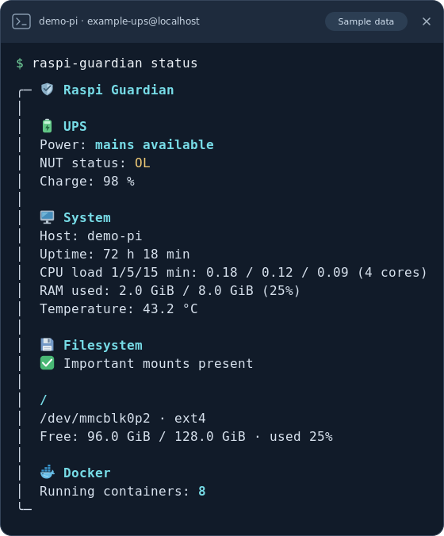
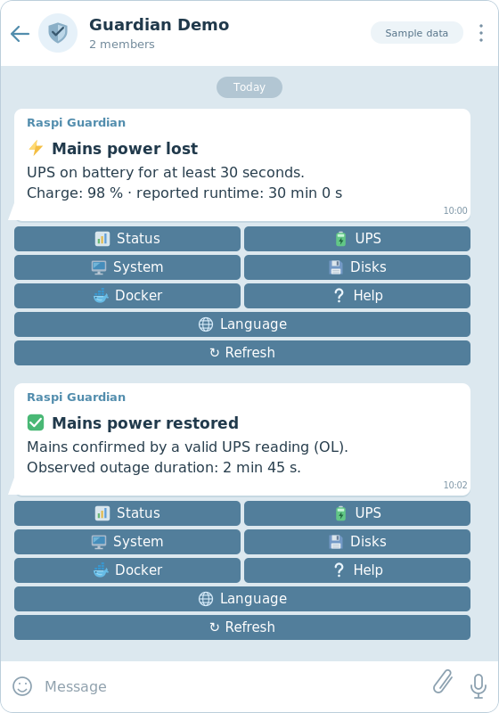

# Raspi Guardian

Monitor your Raspberry Pi or Linux system and its UPS from a private Telegram
group or directly over SSH. Raspi Guardian provides English/Italian Telegram
responses and CLI reports, system and disk diagnostics, and automatic UPS alerts.
English is the default for new installations; Italian is available in both interfaces.

**Docker is optional and disabled by default.** Telegram uses outbound HTTPS;
no web server, webhook or inbound port is needed.

Choose your path:

- **[Quick Start](#quick-start):** install the Telegram bot and enable automatic startup.
- **[CLI-only](#cli-only):** run diagnostics over SSH, without Telegram or a systemd service.
- **[Development](#development):** change, test and deploy the source separately from production.

**NUT manages shutdown independently.** Raspi Guardian reports UPS data and sends
alerts; it does not configure or trigger shutdown. A working, independently
configured NUT shutdown setup remains necessary.


## Screenshots

English examples with synthetic sample data and optional Docker enabled.
Select an image for full size, or go to [Quick Start](#quick-start).

<p>
  <a href="assets/cli-status.svg"></a>
  <a href="assets/telegram-demo.svg"></a>
</p>

## Requirements and compatibility

- Linux with systemd, `/proc` and `/sys`; installation examples target Debian,
  Raspberry Pi OS and compatible distributions.
- An SSH or local Bash terminal and an administrator account with `sudo`.
- Node.js **22**, installed system-wide using the Linux setup guide below.
- NUT client `/usr/bin/upsc` and util-linux `/usr/bin/findmnt`.
- A working NUT server exposing one UPS, locally or over a trusted network.
- For Telegram only: a bot, one authorized chat ID and one authorized user ID;
  outbound HTTPS access to `api.telegram.org`. See the
  [complete Telegram setup guide](docs/telegram-setup.md).
- Optional: Docker Engine and `/usr/bin/docker`, only when explicitly enabled.

Raspberry Pi 5 is the previously verified hardware platform, not a requirement.
There is no model-specific UPS logic: compatibility depends on NUT and the data
provided by its driver. Other Linux hardware is expected to work with the
limitations below, but has not been hardware-tested by this project.

## Quick Start

For a new Raspberry Pi, start with a supported Raspberry Pi OS installation,
network access and a working SSH login with `sudo`. The commands below target
Debian/Raspberry Pi OS. Run each step in order as your normal login user; use
`sudo` only where shown. Stop and resolve any failed command before continuing.
For an existing service, use the [update and rollback guide](docs/development.md#updating-migration-and-rollback).

### 1. Install prerequisites and download Raspi Guardian

Complete [Linux packages and Node.js 22](docs/linux-setup.md#packages-and-nodejs-22),
then return here. That guide includes a complete Node 22 installation when the
distribution does not provide it. No NPM packages or build step are required.

The official public repository is [salva1973/raspi-guardian](https://github.com/salva1973/raspi-guardian).
Uppercase `YOUR_...` values elsewhere in this documentation are placeholders:
replace them before running a command or saving a configuration.

```bash
cd "$HOME"
git clone https://github.com/salva1973/raspi-guardian.git raspi-guardian-setup
cd raspi-guardian-setup
git log -1 --oneline
```

This is a source copy used for installation, not a development environment.
Use an empty destination; do not overwrite an existing checkout. Select a
reviewed release with `git checkout YOUR_RELEASE_TAG` if required. Keep this
shell in `~/raspi-guardian-setup` for the file installation in step 4; if you
reconnect, run `cd "$HOME/raspi-guardian-setup"` first.

### 2. Configure and verify NUT

Follow [NUT setup](docs/linux-setup.md#nut-setup): choose an existing remote NUT
server or configure the local UPS driver, data server and shutdown monitor.
The guide includes file contents, permissions, service startup and `upsc` checks.
Return here only after the configured UPS can be read successfully. Record its
NUT destination, for example `example-ups@localhost`, for step 5.

### 3. Create the private Telegram group and discover IDs

Complete [Telegram setup steps 1–4](docs/telegram-setup.md#1-create-the-bot-with-botfather):
create the bot with BotFather, create a private group, add the bot and discover
`TELEGRAM_CHAT_ID` and `TELEGRAM_ALLOWED_USER_ID` with the included helper.
The helper contacts only Telegram's official API and prompts for the token
without echo; no third-party lookup bot or website is needed.

Keep the bot stopped during discovery. Save the token privately and verify that
the IDs belong to your intended group and your own user. **Return here after
step 4 of that guide**; configuration and startup continue below.

### 4. Install the application files

From the source directory entered in step 1:

```bash
sudo install -d -o root -g root -m 0755 /opt/raspi-guardian /opt/raspi-guardian/src /opt/raspi-guardian/systemd /opt/raspi-guardian/bin /opt/raspi-guardian/docs
sudo install -o root -g root -m 0644 src/*.mjs /opt/raspi-guardian/src/
sudo install -o root -g root -m 0755 bin/raspi-guardian /opt/raspi-guardian/bin/
sudo install -o root -g root -m 0644 docs/*.md /opt/raspi-guardian/docs/
sudo install -o root -g root -m 0644 README.md LICENSE guardian.env.example /opt/raspi-guardian/
sudo install -o root -g root -m 0644 systemd/raspi-guardian.service /opt/raspi-guardian/systemd/
```

These commands install the files under `/opt/raspi-guardian`, owned by root.
They do not start a service. Keep this installed directory unwritable by the bot.
The source copy in your home directory is not used by the running installation.

### 5. Create the service account and secure configuration

For a new installation, create the dedicated account:

```bash
sudo useradd --system --user-group --no-create-home --home-dir /nonexistent --shell /usr/sbin/nologin raspi-guardian
```

If that dedicated account already exists, skip creation and check
`id raspi-guardian` and `getent group raspi-guardian` before proceeding. The unit
requires both the user and group named `raspi-guardian`.

Check that this account can query the UPS. Replace `example-ups@localhost` with
the exact destination verified in step 2, including its remote hostname if used:

```bash
sudo -u raspi-guardian /usr/bin/upsc example-ups@localhost
```

Resolve any NUT access error before starting the bot.

Create the private configuration only if it is absent; never overwrite an
existing credential file with the example:

```bash
sudo install -d -o root -g root -m 0700 /etc/raspi-guardian
if ! sudo test -e /etc/raspi-guardian/telegram.env; then
    sudo install -o root -g root -m 0600 /opt/raspi-guardian/guardian.env.example /etc/raspi-guardian/telegram.env
fi
sudoedit /etc/raspi-guardian/telegram.env
```

In the editor, replace the fictional Telegram token, chat ID and user ID with
those obtained in step 3. Set `GUARDIAN_UPS_NAME` to the destination verified in
step 2. Preserve the group's negative chat ID. Keep
`GUARDIAN_DOCKER_ENABLED=false`; `GUARDIAN_IMPORTANT_MOUNTS=/` is a suitable
initial setting. Add only actual mount points you expect to be mounted.
The optional shutdown warning is disabled unless configured.

Use `NAME=value` without `export` or shell substitutions. Do not put the token
in shell commands or Git. systemd reads the root-only file; the service account
does not need permission to open it. See the [configuration reference](#configuration-reference)
for all options and [Telegram step 5](docs/telegram-setup.md#5-configure-the-private-environmentfile)
for permission checks.

### 6. Install systemd and enable automatic startup

Install the supplied unit:

```bash
sudo install -o root -g root -m 0644 /opt/raspi-guardian/systemd/raspi-guardian.service /etc/systemd/system/raspi-guardian.service
```

The public unit uses `/usr/bin/node`. If the Linux setup guide installed Node 22
at `/usr/local/bin/node`, run this block to select it in a local override.
The block does nothing when `/usr/bin/node` already supplies Node 22:

```bash
(
set -eu
case "$(/usr/bin/node --version 2>/dev/null || true)" in
    v22.*) ;;
    *)
        /usr/local/bin/node -e 'if (process.versions.node.split(".")[0] !== "22") process.exit(1)'
        sudo install -d -o root -g root -m 0755 /etc/systemd/system/raspi-guardian.service.d
        sudo tee /etc/systemd/system/raspi-guardian.service.d/node.conf > /dev/null <<'UNIT'
[Service]
ExecStart=
ExecStart=/usr/local/bin/node /opt/raspi-guardian/src/guardian.mjs
UNIT
        ;;
esac
)
```

Do not overwrite an existing `node.conf` on a previously customized installation;
review its local overrides first. Ensure the ID discovery helper has exited and
no other process uses this token. Then start the bot and enable boot startup:

```bash
sudo systemctl daemon-reload
sudo systemctl enable --now raspi-guardian.service
sudo systemctl status raspi-guardian.service --no-pager
sudo journalctl -u raspi-guardian.service -n 50 --no-pager
```

### 7. Verify and start using the bot

Check that the service stays `active (running)`. In the private group, from the
authorized user, send the following, replacing `YOUR_BOT_USERNAME` with the
username supplied by BotFather (without its leading `@`):

```text
/help@YOUR_BOT_USERNAME
/status@YOUR_BOT_USERNAME
/ups@YOUR_BOT_USERNAME
/lang@YOUR_BOT_USERNAME en
/lang@YOUR_BOT_USERNAME it
```

Check that UPS data matches `upsc`, inline refresh works, and the language
changes. No power interruption or shutdown is needed for this check. If anything
fails, use [Telegram troubleshooting](docs/telegram-setup.md#8-common-problems).
You can now use the [Telegram commands](#telegram-commands-it--en) and
[service controls](#everyday-service-management). The bot also checks UPS status
automatically. The [CLI-only section](#cli-only) explains how to add the SSH command
to this installation; skip its file installation if you completed step 4 here.

## CLI-only

Use this path for SSH diagnostics without creating a Telegram bot, service
account, credential file or systemd service.

1. Complete [Quick Start step 1](#1-install-prerequisites-and-download-raspi-guardian)
   for Linux tools, Node 22 and the source download.
2. Run the file-copy block in [step 4](#4-install-the-application-files).
   Skip it if `/opt/raspi-guardian` was already installed with Quick Start.
3. Continue below. For `status` and `ups`, also configure a readable NUT
   destination using [NUT setup](docs/linux-setup.md#nut-setup).
   `system`, `disks` and `help` do not require a UPS destination.

Do not perform Quick Start steps 3, 5 or 6 for a CLI-only installation. Docker is
optional and remains disabled by default. Each invocation produces one report
and exits; it does not start Telegram polling or background monitoring.

### Install the global command

Create this symlink once; check any existing command/link first. The command
does not overwrite it:

```bash
sudo install -d -o root -g root -m 0755 /usr/local/bin
sudo ln -s /opt/raspi-guardian/bin/raspi-guardian /usr/local/bin/raspi-guardian
export PATH="/usr/local/bin:$PATH"
raspi-guardian help
raspi-guardian system
raspi-guardian disks
```

Keep `/usr/local/bin` on your login `PATH`. For sessions without it, add the
export above to your own `~/.profile`. You can also use an explicit path for
both Node lookup and the launcher:

```bash
PATH=/usr/local/bin:/usr/bin:/bin /opt/raspi-guardian/bin/raspi-guardian help
```

Run diagnostics as your SSH user; the command grants no extra permissions and
does not change the UPS, mounts or containers.

### Non-secret CLI configuration

The CLI reads its diagnostic options from your shell environment. If you also
run the Telegram bot, keep `/etc/raspi-guardian/telegram.env` root-only: the CLI
never reads or sources it, and SSH shells do not inherit the service environment.
Supply just the non-secret `GUARDIAN_UPS_NAME`, `GUARDIAN_IMPORTANT_MOUNTS` and
optional `GUARDIAN_DOCKER_ENABLED` in your shell. To persist them, add reviewed
exports to your own shell profile or a separate non-secret shell configuration.

Replace `example-ups@localhost` with your verified NUT destination before using
`status` or `ups`. Keep the mount list at `/` unless other mount points are
actually required on this host:

```bash
export GUARDIAN_UPS_NAME=example-ups@localhost
export GUARDIAN_IMPORTANT_MOUNTS=/
export GUARDIAN_DOCKER_ENABLED=false
```

An administrator can communicate these diagnostic values separately from the
token. Do not loosen credential-file permissions, copy its Telegram values or
source the systemd EnvironmentFile as shell code. No sudo is required for CLI
startup; individual diagnostics still depend on local service/client permissions.

```bash
raspi-guardian status
raspi-guardian ups
raspi-guardian disks --no-color
```

To enable a Docker query explicitly on an existing local Docker installation:

```bash
GUARDIAN_DOCKER_ENABLED=true raspi-guardian docker
```

This requires the calling user's existing Docker socket permissions, which
carry the [Docker privilege risk](#optional-docker-diagnostics).

### Optional rsg alias

In an interactive Bash session:

```bash
alias rsg='raspi-guardian'
rsg help
rsg status
```

For future interactive Bash sessions, add the alias line to your own
`~/.bashrc` and reload with `source ~/.bashrc`. The alias supplies no diagnostic
variables or permissions; `rsg status` uses the non-secret exports above.
Scripts should use the full command because they normally do not expand aliases.

Output uses a compact text frame and ANSI highlights on interactive terminals.
Pipes, `TERM=dumb`, any defined `NO_COLOR` (including empty) or `--no-color`
disable ANSI colors. For example: `raspi-guardian system --no-color`.
Exit codes: `0` report produced, `1` failed/incomplete diagnostic request,
`2` invalid command/configuration or explicitly requested Docker while disabled.
A language-save failure returns `1` and preserves the previous preference.
Sensor values unavailable on the host remain `n/a` in English or `n/d` in Italian.
Mount/health warnings are report content, not execution errors. Lists retain the shared
engine's length limit and state when additional entries are omitted.

### CLI language and persistence

English is the default. Select Italian or return to English as your normal Linux
login user; no sudo, bot configuration or database is needed:

```bash
raspi-guardian lang
# Current CLI language: English (en).
raspi-guardian lang it
# ✅ Lingua CLI impostata: Italiano (it).
raspi-guardian lang en
# ✅ CLI language set: English (en).
```

The choice applies to subsequent commands and survives logout and a new SSH
connection. Each Linux user's preference is stored as `{"language":"en"}` or
`{"language":"it"}` in `${XDG_CONFIG_HOME:-$HOME/.config}/raspi-guardian/cli.json`.
`XDG_CONFIG_HOME` must be absolute; a relative value is ignored in favor of
`$HOME/.config`. Run as the same user with the same configuration location after
reconnecting. Using sudo selects root's preference instead of yours.

The CLI creates its own `raspi-guardian` configuration directory with mode `0700`
and writes an exclusive `0600` temporary file, syncs it and renames it atomically.
Missing, corrupt, oversized, unreadable or unsafe settings fall back to English
without exposing their contents. Reading does not create files. CLI settings-file
symlinks are not followed; saving replaces the link without modifying its target.
A symlink or a directory owned by another user at the application directory is
rejected. Publicly accessible application directories or files are ignored on
read; a successful save restores private permissions. Failed saves preserve the
previous file. The JSON contains only the language, never Telegram credentials.

CLI and Telegram preferences are independent. `raspi-guardian lang it` affects
only this Linux user's terminal reports; Telegram `/lang it` affects only the
authorized chat and its notifications. The CLI never reads the bot's state or
credential files.

Example English UPS report (illustrative values; technical data is unchanged):

```text
╭─ Raspi Guardian · UPS
│  🔋 UPS
│  Power: mains available
│  NUT status: OL
│  Charge: 75 %
│  Reported runtime: 13 min 20 s
│  Estimate reported by the UPS, not a shutdown countdown.
│  UPS load: 20 %
│  Input: 230 V
│  Model: Example Example-UPS
│  NUT: example-ups@localhost
╰─
```

## Telegram commands (IT / EN)

English is the default when there is no valid saved Telegram preference. Use
`/lang` for the selector, `/lang it` for Italian or `/lang en` for English.
Existing saved preferences are preserved when upgrading. The CLI language is
independent. Command names are identical in both languages; labels, buttons and
alerts change.

| Command | Italiano | English |
| --- | --- | --- |
| `/start`, `/help` | Comandi e pulsanti | Commands and navigation |
| `/status` | Riepilogo UPS, sistema, dischi; Docker se abilitato | UPS, system, disks overview; Docker if enabled |
| `/ups` | Alimentazione, flag, carica, autonomia, carico, tensione, modello e destinazione NUT | Power, flags, charge, runtime, load, voltage, model and NUT destination |
| `/system` | Host, uptime, carico CPU, RAM, temperatura | Host, uptime, CPU load, RAM, temperature |
| `/disks` | Mount, sorgenti, capacità, spazio libero e avvisi | Mounts, sources, capacity, free space and warnings |
| `/docker` | Container attivi e health, solo se abilitato | Running containers and health, only if enabled |
| `/lang` | Selettore Italiano / English | Italian / English selector |
| `/lang it`, `/lang en` | Imposta la lingua | Set the language |

Inline refresh edits the current message; text commands send a new one. Group
commands such as `/ups@your_bot` and `/lang@your_bot en` are accepted only for
the bot's verified username. Unknown commands and diagnostic arguments are
ignored. Invalid `/lang` arguments show usage in the current language.

## Everyday service management

```bash
sudo systemctl is-enabled raspi-guardian.service
sudo systemctl status raspi-guardian.service --no-pager
sudo journalctl -u raspi-guardian.service -n 50 --no-pager
sudo journalctl -u raspi-guardian.service -f
sudo systemctl stop raspi-guardian.service
sudo systemctl start raspi-guardian.service
sudo systemctl restart raspi-guardian.service
```

These are individual operations, not a script to run in sequence. Press Ctrl-C
to leave live logs; it does not stop the service. `enable --now` above starts
the bot and enables boot startup. `stop` suspends it until a manual start or
reboot; `sudo systemctl disable --now raspi-guardian.service` also disables
boot startup. A deliberate stop is not undone by `Restart=on-failure`.
After changing only `telegram.env`, restart the bot to load it. After editing a
unit or drop-in, run `sudo systemctl daemon-reload` before restarting.

## Automatic UPS notifications

The configured UPS is polled about every 5 seconds, without overlapping checks.

- **Power outage:** `OB` observed for at least 30 seconds, once per episode.
- **Power restored:** a valid `OL` after observed `OB`, including short outages.
- **Critical UPS:** `LB` (low battery) or `FSD` (forced shutdown requested),
  deduplicated while critical status persists, including across restoration.
- **Optional shutdown warning:** once the configured number of observed outage
  seconds has elapsed. Disabled when the option is absent or empty.

To enable the optional warning, set, for example,
`GUARDIAN_SHUTDOWN_WARNING_SECONDS=300` in the private EnvironmentFile and restart
only the bot. Omit the variable or leave it empty to disable it; `0` is invalid.
The warning reports the observed duration and configured threshold.
It does **not** predict when NUT will shut down the system. The bot neither
reads nor verifies NUT timers. Reported battery runtime is the UPS's estimate,
not a shutdown countdown. NUT may act earlier due to LB/FSD.

Failed, empty, contradictory (`OL OB`) or unrecognized power readings preserve
the previous episode and never announce restoration. Timing starts at the first
valid battery reading, including when the bot starts during an outage. It may
lag behind NUT, and missed readings cannot reveal a temporary restoration.

Episode state and deduplication are in memory; restarting the bot resets them.
Successful alerts are not repeated in the same episode; failed sends are retried.
A lost Telegram response after delivery may still cause a duplicate. Delivery
cannot be guaranteed during network or power failures.

## Configuration reference

Configure `/etc/raspi-guardian/telegram.env` using
[`guardian.env.example`](guardian.env.example). It contains fictional values only.
The file uses systemd `EnvironmentFile` syntax: `NAME=value`, without `export`,
shell commands or variable expansion. Keep credentials outside the checkout.

| Variable | Default | Meaning |
| --- | --- | --- |
| `TELEGRAM_BOT_TOKEN` | Required | Private BotFather token |
| `TELEGRAM_CHAT_ID` | Required | Nonzero numeric chat ID; may be negative for groups |
| `TELEGRAM_ALLOWED_USER_ID` | Required | Positive numeric user ID |
| `GUARDIAN_UPS_NAME` | Required | One validated NUT destination, `upsname[@hostname[:port]]` |
| `GUARDIAN_DOCKER_ENABLED` | `false` | Only literal `true` enables Docker; `false` disables it |
| `GUARDIAN_SHUTDOWN_WARNING_SECONDS` | Disabled | Positive whole seconds since the first observed battery reading; omitted or empty disables the warning |
| `GUARDIAN_IMPORTANT_MOUNTS` | `/` | Comma-separated absolute mount points that should be mounted |

Invalid configuration stops startup with an error that does not include the
supplied values. The NUT destination accepts letters, digits, `_`, `.` and `-`
in the UPS name, with a letter, digit or `_` first. Hosts may be DNS names, IPv4
addresses or bracketed IPv6 addresses; ports are 1–65535. Whitespace, shell
syntax and leading options are rejected. The destination is passed as one
argument to `upsc` and displayed unchanged in the UPS view. Total length is
limited to 512 characters. IPv6 zone identifiers are not supported.

For example, `GUARDIAN_IMPORTANT_MOUNTS=/,/srv/data` checks two actual mounts;
the presence of a directory alone does not count. Add `/boot/firmware` only on
systems where it should be mounted separately. Mount warnings appear in command
responses, not as automatic notifications.

Both the chat ID **and** user ID must match, including for inline callbacks.
In a group, all participants may see diagnostic responses and notifications,
even though only the authorized user can request them or change the language.

## Optional Docker diagnostics

Leave `GUARDIAN_DOCKER_ENABLED=false` unless you explicitly need Docker status.
When disabled the bot never invokes Docker or accesses its socket, omits Docker
from help, summaries and buttons, and ignores `/docker` and old Docker callbacks.
Docker does not need to be installed.

To enable an existing local Docker Engine installation, set this in the private
configuration:

```dotenv
GUARDIAN_DOCKER_ENABLED=true
```

If you accept the privilege implications, use
`sudo systemctl edit raspi-guardian.service` to add this local drop-in (the `docker` group
must already exist):

```ini
[Service]
SupplementaryGroups=docker
```

Then reload systemd and restart only the bot in a planned maintenance window.
This avoids adding Docker privileges to the public unit or permanently changing
account group membership. If permission or Docker availability is missing, the
Docker view reports unavailable data and other diagnostics continue working.

**Access to the Docker group/socket grants effectively root-level privileges.**
`ProtectSystem=strict` does not prevent a compromised process from using that
socket to control the host. Enable access only for trusted code and operators.
See [Docker's security warning](https://docs.docker.com/engine/install/linux-postinstall/).
The supported setup uses the local default socket; custom Docker contexts and
rootless sockets are not configured by the bot.

## systemd, ownership and language persistence

The public unit runs as `raspi-guardian:raspi-guardian`, without internal sudo.
systemd reads the root-only configuration file and supplies the environment to
the service. `StateDirectory=raspi-guardian` and `StateDirectoryMode=0700` create
`/var/lib/raspi-guardian` owned by the service account, with write access despite
`ProtectSystem=strict`. `STATE_DIRECTORY` is supplied by systemd; the application
falls back to `/var/lib/raspi-guardian` outside systemd.

| Path | Owner | Mode / purpose |
| --- | --- | --- |
| `/opt/raspi-guardian` and code subdirectories | `root:root` | `0755`; readable, not writable by the bot |
| Application modules, public docs and installed unit | `root:root` | `0644` |
| `/opt/raspi-guardian/bin/raspi-guardian` | `root:root` | `0755`; CLI launcher |
| `/etc/raspi-guardian` | `root:root` | `0700`; private configuration directory |
| `/etc/raspi-guardian/telegram.env` | `root:root` | `0600`; credentials, read by systemd |
| `/var/lib/raspi-guardian` | Service user/group | `0700`; managed by systemd |
| `/var/lib/raspi-guardian/settings.json` | Service user/group | `0600`; language only |
| Local systemd drop-ins | `root:root` | `0644`; no secrets |

The unit retains `NoNewPrivileges`, `ProtectSystem=strict`, `ProtectHome`,
`PrivateTmp` and `UMask=0077`. It orders startup after the network and NUT server,
without making Docker a dependency. Failures restart the bot after 10 seconds;
SIGTERM/SIGINT cancel outstanding work, with a 5-second systemd stop limit.
See [systemd execution and state directories](https://www.freedesktop.org/software/systemd/man/latest/systemd.exec.html).
`After=nut-server.service` orders startup only when that unit is also started;
it does not enable NUT or guarantee UPS readiness, especially with a remote UPS.

### Installation-specific systemd overrides

The public unit always uses the dedicated `raspi-guardian` user and group,
with **no Docker group access by default**. A particular installation may retain
its own existing account, group and optional Docker membership in
`/etc/systemd/system/raspi-guardian.service.d/override.conf`, created with
`sudo systemctl edit raspi-guardian.service`. For example, with fictional values:

```ini
[Service]
User=YOUR_EXISTING_ACCOUNT
Group=YOUR_EXISTING_GROUP
# Optional, only when deliberately accepting the Docker privilege risk:
SupplementaryGroups=docker
```

Keep the real drop-in on the installed host, outside this repository. Do not
replace the dedicated account in the public unit with a personal account.
Record the effective identity and group grants in private installation notes;
`systemctl cat raspi-guardian.service` shows unit/drop-in provenance, and
`systemctl show raspi-guardian.service -p User -p Group -p SupplementaryGroups`
shows the merged settings without displaying the credential file. When migrating,
preserve the existing state owner as described in the
[migration guide](docs/development.md#migration-from-v11).

**The Docker socket grants effectively root-equivalent control of the host.**
Read-only CLI commands do not reduce the privileges of the account granted
socket access. A personal service account may also expose more host resources
than a dedicated account. Keep local exceptions explicit and privately tracked.

### Language persistence

English is the initial language for a new installation. Existing saved Italian
or English preferences are preserved. `/lang en` or `/lang it` changes it for the
whole authorized chat, including future notifications during an ongoing outage.
Technical data stays unchanged. The only persisted content is
`{"language":"en"}` or `{"language":"it"}`. Writes use an exclusive `0600`
temporary file, sync and atomic rename in the same directory. Failed saves keep
the previous language. Missing, invalid or unreadable settings fall back to
English without logging file contents. Settings-file symlinks are not followed.
The bot does not create the state directory itself. This service state is
separate from the per-user [CLI settings](#cli-language-and-persistence).

## Development

Installing and using Raspi Guardian does not require a development checkout or
knowledge of its internal modules. For source changes, use the separate
[Development and controlled deployment guide](docs/development.md): it covers
`/opt/raspi-guardian-dev`, offline tests, review, commit/push, controlled deployment,
migration and rollback. Production remains at `/opt/raspi-guardian`.

## Security and known limitations

- Telegram input never becomes a command argument. Diagnostic binaries use
  fixed paths, `execFile` without a shell, a 5-second timeout, bounded output and
  an environment containing only `PATH`, `LANG` and `LC_ALL`; Telegram secrets
  are not inherited by child processes.
- Callbacks require the authorized chat and user, valid message/callback IDs and
  an action from a closed list. There is no reboot, shutdown or arbitrary shell
  command exposed through Telegram.
- Logs use fixed messages without tokens, API URLs, raw remote responses,
  command stderr or incoming text. The token remains in the bot's environment
  and memory; privileged local operators can access it.
- Diagnostics intentionally reveal hostname, filesystem sources, UPS identifiers
  and container names to the authorized chat. Choose a private chat or trusted group.
- CPU load is load average, not a percentage. Used RAM excludes `MemAvailable`.
  `/sys/class/thermal/thermal_zone0/temp` may be absent or refer to a non-CPU sensor
  on other hardware. Missing data is reported as unavailable.
- Disk usage warnings begin at 90%. `findmnt --df` excludes pseudo-filesystems.
  Long lists are shortened to fit Telegram limits. Docker lists only running
  containers; an absent healthcheck does not mean a container is healthy.
- Critical-only flags without a valid `OL`/`OB`, or contradictory power flags,
  are rejected as invalid readings. No separate critical alert is sent from such
  a reading. If a blackout alert send fails, a critical alert due in the same
  observation is deferred to a later attempt. These existing behaviors are retained.
- Telegram timeouts, `429` cooldown and polling backoff handle temporary errors.
  Authentication errors and polling conflicts stop the bot; check the token,
  absence of a webhook and single-instance operation. The bot does not remove webhooks.

## License and publication

The project uses the [MIT license](LICENSE). Review the existing copyright
notice and release contents before publication.

The ignore rules cover local environment files, credentials directories, backups
and private settings while keeping `guardian.env.example` versionable. They do
not remove files already tracked in Git. Before publishing, review the exact
release contents and Git author metadata, confirm the copyright holder, and
repeat checks on the final approved tree. The screenshots above use synthetic
sample data.
